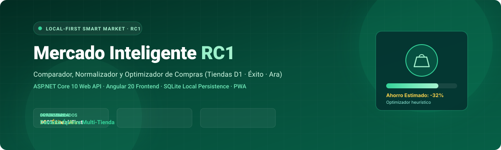
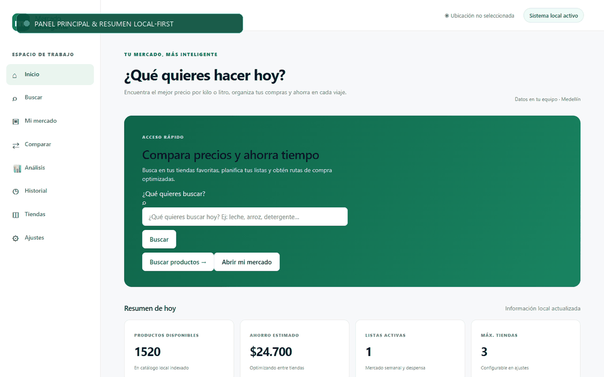
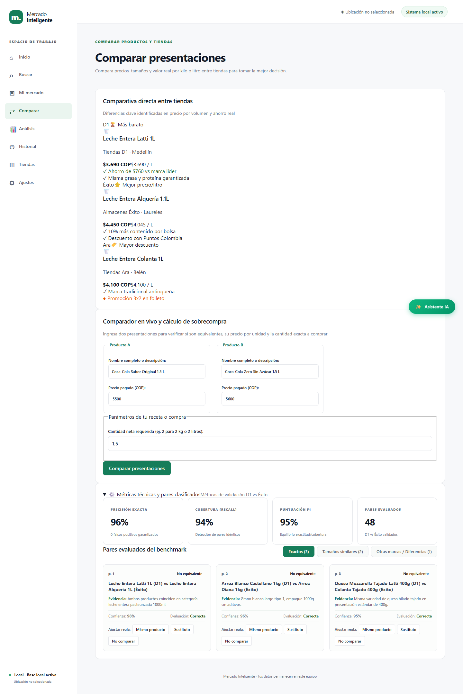
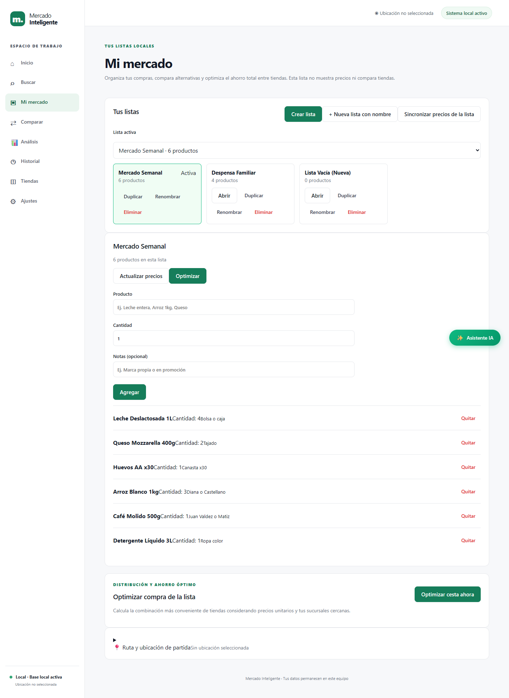
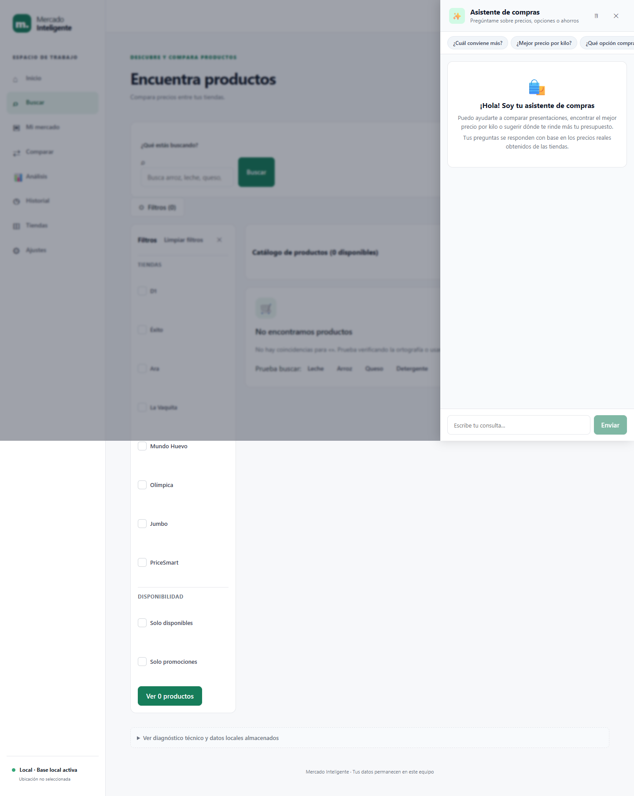
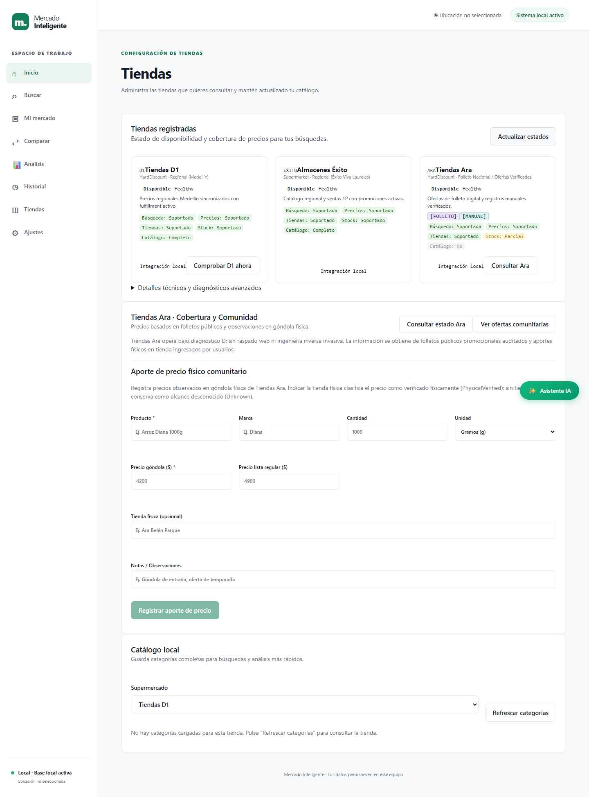
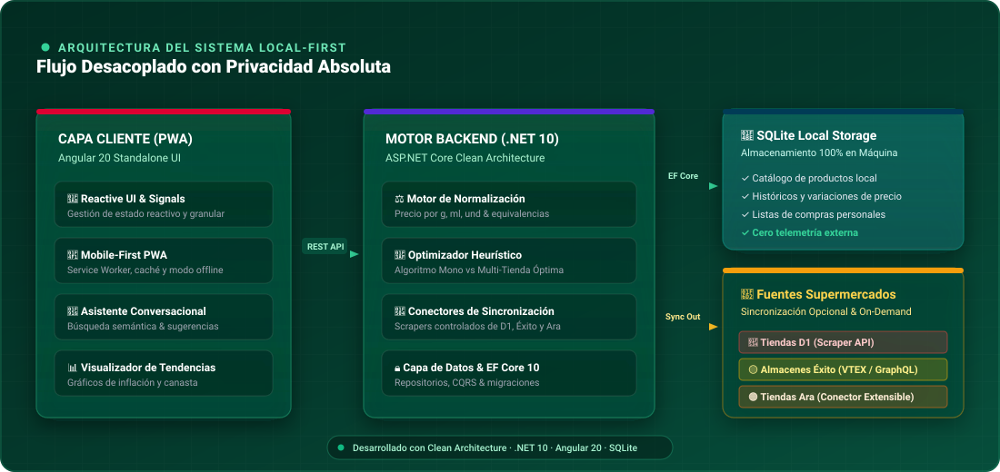
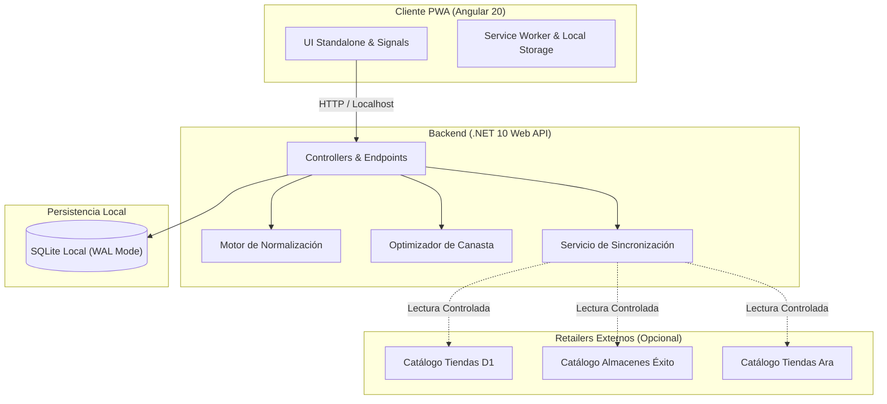

<p align="center">
  
</p>

<p align="center">
  
  
  
  
  
  
</p>

<p align="center">
  
</p>

## 📌 Tabla de Contenidos

- [🛒 Visión General](#-visión-general)
- [🎬 Recorrido Interactivo (Demo en Vivo)](#-recorrido-interactivo-demo-en-vivo)
- [⚡ Capacidades Clave](#-capacidades-clave)
- [📸 Galería de Interfaz (UI Showcase)](#-galería-de-interfaz-ui-showcase)
- [🏛️ Arquitectura del Sistema](#️-arquitectura-del-sistema)
- [🛠️ Pila Tecnológica](#️-pila-tecnológica)
- [🚀 Inicio Rápido](#-inicio-rápido)
- [📁 Estructura del Repositorio](#-estructura-del-repositorio)
- [🔒 Privacidad y Almacenamiento Local](#-privacidad-y-almacenamiento-local)
- [📄 Licencia y Créditos](#-licencia-y-créditos)

<p align="center">
  
</p>

## 🛒 Visión General

**Mercado Inteligente** es una solución integral de escritorio y **PWA Local-First** concebida para el análisis, normalización comparativa y optimización matemática de listas de compras en las principales cadenas de retail de Colombia: **Tiendas D1**, **Almacenes Éxito** y **Tiendas Ara**.

### ¿Por qué Mercado Inteligente?
- **Sin Dependencia de la Nube:** Todos tus catálogos, listas de mercado, notas personales y registros históricos residen exclusivamente en tu base de datos SQLite local.
- **Transparencia en Precios:** Descubre el precio real por unidad de medida (precio por gramo o mililitro) para neutralizar trampas comerciales de presentación o empaque.
- **Ahorro Heurístico Calculado:** El motor compara compras consolidadas en una sola tienda contra compras inteligentes multi-tienda, indicando con exactitud cuántos pesos colombianos ($ COP) ahorras en cada decisión.

---

## 🎬 Recorrido Interactivo (Demo en Vivo)

A continuación se muestra una animación del flujo de trabajo integral en Mercado Inteligente: desde el panel principal hasta el optimizador matemático de canasta y el asistente conversacional con inteligencia artificial:

<p align="center">
  
</p>

---

## ⚡ Capacidades Clave

| Módulo | Descripción Funcional |
| :--- | :--- |
| **⚖️ Motor de Normalización de Unidades** | Convierte automáticamente unidades arbitrarias (libras, kilos, gramos, onzas, litros, mililitros) a un valor base uniforme para comparaciones 1:1 justas. |
| **🎯 Optimizador Heurístico de Canasta** | Calcula la bifurcación entre **Estrategia Monotienda** (la mejor tienda para comprarlo todo) y **Estrategia Multi-tienda** (la combinación óptima entre D1, Éxito y Ara). |
| **🤖 Asistente de Compras con IA** | Búsqueda semántica inteligente y recomendaciones contextuales para sustitución de productos y recetas económicas. |
| **📈 Trazabilidad Histórica de Tarifas** | Registro cronológico local de variaciones de precio por producto para auditar descuentos y detectar falsas rebajas. |
| **🔄 Conectores On-Demand Desacoplados** | Sincronización controlada y bajo demanda contra catálogos externos sin exponer datos ni credenciales del usuario. |
| **📱 Experiencia Responsive & PWA** | Adaptable a pantallas ultra-anchas de escritorio, portátiles y smartphones con soporte para instalación offline. |

---

## 📸 Galería de Interfaz (UI Showcase)

### 1. Panel de Control y Comparativa Multi-Tienda Directa
Vista consolidada de productos con cálculo instantáneo de valor unitario por gramo o mililitro.

| Panel Principal (Desktop) | Comparador Multi-Tienda (D1 · Éxito · Ara) |
| :---: | :---: |
|  |  |

<br>

### 2. Algoritmo Optimizador y Analítica Histórica
Desglose detallado del ahorro máximo en canasta familiar y gráficas interactivas de evolución de precios.

| Optimizador Matemático de Canasta | Historial de Precios e Inflación |
| :---: | :---: |
|  |  |

<br>

### 3. Asistente Conversacional & Sincronización de Tiendas
Interacción guiada por inteligencia artificial para recetas y compras, junto con diagnóstico de estado de conectores.

| Asistente IA de Compras | Monitor y Salud de Conectores |
| :---: | :---: |
|  |  |

<br>

### 4. Experiencia Móvil PWA
Diseño táctil ergonómico optimizado para compras directas en el pasillo del supermercado.

<p align="center">
  
</p>

---

## 🏛️ Arquitectura del Sistema

La solución adopta los principios de **Clean Architecture** con separación de responsabilidades y total soberanía de datos del usuario:

<p align="center">
  
</p>



---

## 🛠️ Pila Tecnológica

### Backend (.NET Core 10)
- **Framework:** ASP.NET Core 10 Web API
- **Arquitectura:** Clean Architecture (Domain, Application, Infrastructure, Api)
- **ORM & Persistencia:** Entity Framework Core 10 con SQLite (WAL journal mode)
- **Patrones:** CQRS, Repository Pattern, Dependency Injection nativo

### Frontend (Angular 20)
- **Framework:** Angular 20 (Standalone Components, Signals reactivos)
- **Estilos & UI:** TailwindCSS, DaisyUI y tokens de diseño personalizados
- **Capacidades PWA:** Web App Manifest, Service Workers, soporte Offline First

### Scripts & Automatización
- **PowerShell 7 / 5.1:** Scripts de compilación unificada, orquestación y testing automatizado

---

## 🚀 Inicio Rápido

### Prerrequisitos
- **Sistema Operativo:** Windows 10/11 (x64), Linux o macOS
- **.NET SDK:** 10.0 o superior
- **Node.js:** 20.x, 22.x o 24.x LTS
- **PowerShell:** 5.1+ o PowerShell Core 7+

### 1. Clonar el Repositorio
```bash
git clone https://github.com/santi-osp/Mercado-Inteligente.git
cd Mercado-Inteligente
```

### 2. Ejecutar la Aplicación Completa
Para arrancar el backend compilado y el cliente Angular en un solo comando:

```powershell
.\scripts\run-app.ps1
```

La interfaz quedará accesible de inmediato en:
👉 **`http://localhost:5000`**

### 3. Modo Desarrollo (Hot-Reload)
Si deseas modificar el frontend y backend en caliente con proxy automático:

```powershell
.\scripts\run-app.ps1 -Dev
```
- **Backend API:** `http://127.0.0.1:5000`
- **Angular Dev Server:** `http://localhost:4200`

### 4. Ejecutar Pruebas Automatizadas
```powershell
.\scripts\test.ps1
```

---

## 📁 Estructura del Repositorio

```text
Mercado-Inteligente/
├── assets/                    # Iconografía, logotipos PWA e ilustraciones
├── docs/                      # Documentación técnica completa
│   ├── architecture/          # Decisiones y diagramas de arquitectura
│   ├── images/                # Banners vectoriales, GIFs y capturas oficiales
│   │   ├── banner.svg         # Hero banner SVG
│   │   ├── architecture.svg   # Diagrama de arquitectura SVG
│   │   ├── divider.svg        # Separador decorativo SVG
│   │   ├── walkthrough.gif    # Demo animada del flujo de trabajo
│   │   └── screenshots/       # Capturas oficiales de alta resolución
│   ├── decisions/             # Architecture Decision Records (ADRs)
│   ├── providers/             # Especificaciones de conectores D1, Éxito y Ara
│   └── ui-audit/              # Auditoría visual completa
├── goals/                     # Roadmap y especificaciones de metas técnicas
├── scripts/                   # Scripts PowerShell de compilación, ejecución y test
│   ├── build.ps1              # Compilación completa backend y frontend
│   ├── run-app.ps1            # Lanzador unificado para desarrollo y producción
│   └── test.ps1               # Ejecutor de suites de pruebas unitarias
├── src/
│   ├── backend/               # Solución ASP.NET Core 10 Web API
│   │   ├── MercadoInteligente.Api
│   │   ├── MercadoInteligente.Application
│   │   ├── MercadoInteligente.Domain
│   │   └── MercadoInteligente.Infrastructure
│   └── frontend/              # Aplicación Angular 20 Standalone PWA
├── tests/                     # Pruebas automatizadas xUnit (.NET 10)
├── LICENSE                    # Licencia MIT de código abierto
└── README.md                  # Documentación principal
```

---

## 🔒 Privacidad y Almacenamiento Local

Mercado Inteligente fue diseñado bajo la premisa de **Privacidad por Diseño**:
- Ningún dato de compras, listas, presupuestos o preferencias personales se envía a servidores de analítica.
- Toda la base de datos se almacena en un archivo local `*.db` en la máquina del usuario.
- Los scrapers y conectores de consulta operan únicamente bajo petición expresa del usuario para actualizar tarifas.

---

## 📄 Licencia y Créditos

Este proyecto está bajo la **Licencia MIT**. Consulta el archivo [LICENSE](file:///C:/Users/santi/Documents/0%20REPOSITORIOS/Mercado_Inteligente/LICENSE) para obtener más detalles.

### Autor y Mantenedor
**Santiago Ospina Arango**  
- **GitHub:** [@santi-osp](https://github.com/santi-osp)  
- **Enfoque:** Arquitectura de Software · Soluciones Local-First · .NET Core / Angular · Automatización

<p align="center">
  
</p>

<p align="center">
  <sub>Mercado Inteligente © 2026 · Desarrollado con dedicación para el ahorro inteligente de las familias</sub>
</p>
