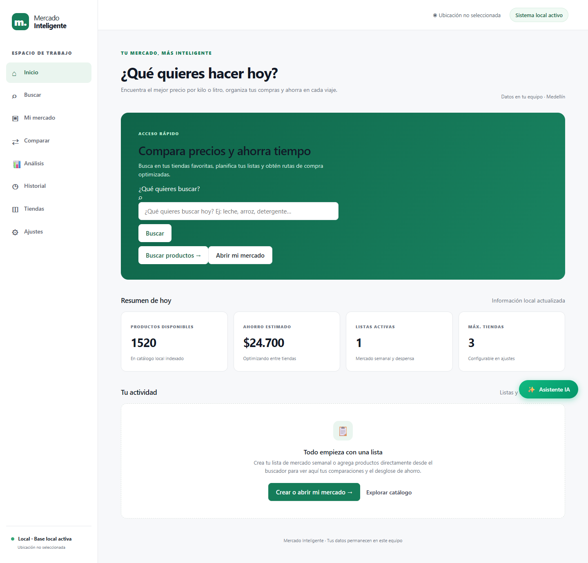
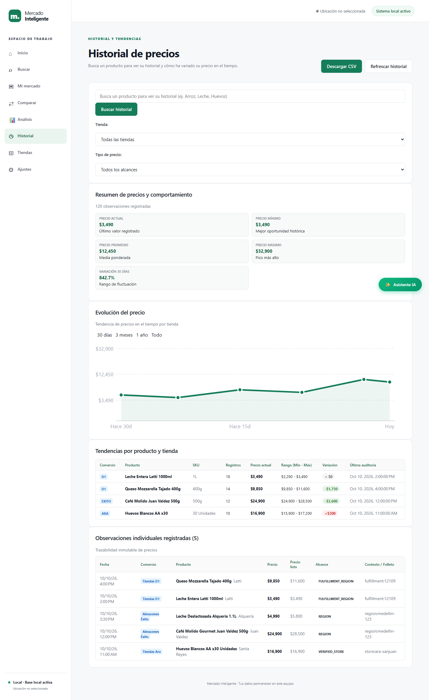
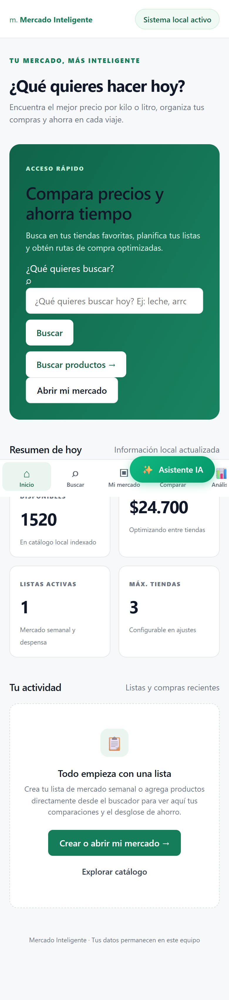
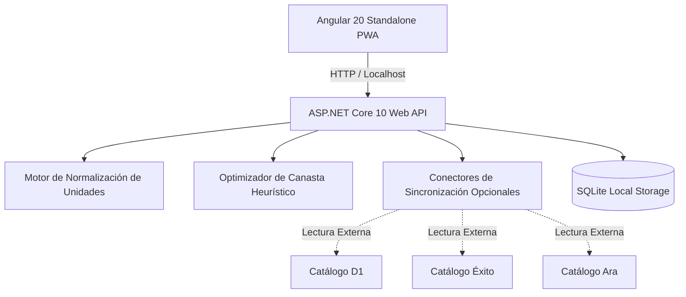

<p align="center">
  
</p>

<p align="center">
  
  
  
  
  
  
</p>

<p align="center">
  
</p>

## 🛒 Visión General

**Mercado Inteligente (RC1)** es una solución de escritorio y PWA **local-first** diseñada para el análisis, normalización, comparación y optimización de listas de compras en las principales cadenas de supermercados de Colombia (**Tiendas D1**, **Almacenes Éxito** y **Tiendas Ara**).

A diferencia de los servicios comerciales tradicionales basados en la nube, Mercado Inteligente opera con **privacidad absoluta**: todos los catálogos de productos, históricos de precios, listas de mercado y combinaciones optimizadas residen exclusivamente en la base de datos SQLite de tu máquina local. Los conectores externos hacia los supermercados se activan de forma controlada y opcional para refrescar tarifas cuando el usuario lo decide.

---

## 📸 Recorrido Visual (UI Showcase)

### 1. Panel Principal & Comparativa Multi-Tienda
Vista unificada de productos con cálculo automático de valor por unidad de medida (precio por gramo o mililitro) para comparativas directas y justas entre marcas.

| Panel Principal (Desktop) | Comparador Multi-Tienda Directo |
| :---: | :---: |
|  |  |

<br>

### 2. Optimizador Inteligente de Canasta y Análisis Histórico
El algoritmo analiza tu lista de mercado y calcula la estrategia de compra más económica: compra centralizada en una sola tienda vs. compra dividida óptima con desglose de ahorro en pesos colombianos ($ COP).

| Optimizador de Compras y Canasta | Histórico de Precios e Inflación |
| :---: | :---: |
|  |  |

<br>

### 3. Experiencia Móvil / PWA Responsive
Diseño totalmente adaptable a pantallas táctiles de smartphone con modo oscuro y atajos rápidos de escaneo y consulta.

<p align="center">
  
</p>

<p align="center">
  
</p>

## ⚡ Capacidades Principales

- **📊 Normalizador de Unidades:** Convierte automáticamente presentaciones dispersas (libras, kilos, onzas, litros, mililitros) a un valor unitario estándar para evitar trampas de empaque.
- **🎯 Algoritmo de Compra Óptima:**
  - *Opción Monotienda:* La tienda más barata para comprar toda tu lista en un solo viaje.
  - *Opción Multi-tienda:* La combinación matemática perfecta entre D1, Éxito y Ara para maximizar tu ahorro.
- **🔒 Privacidad Local-First:** No requiere cuentas externas, ni almacenamiento en nubes públicas, ni rastreadores de publicidad.
- **📈 Historial de Precios y Tendencias:** Registro cronológico de cambios de precio para identificar promociones reales vs falsos descuentos.
- **⚡ Proceso Unificado:** Script en PowerShell que compila y orquesta el backend ASP.NET Core y el cliente Angular en un solo clic.

---

## 🏛️ Arquitectura del Sistema



---

## 🚀 Inicio Rápido en Un Solo Paso

Para iniciar la aplicación completa (backend compilado y frontend Angular sirviendo en `http://localhost:5000`):

```powershell
.\scripts\run-app.ps1
```

*Si el frontend aún no ha sido compilado, el script detectará las dependencias y lo compilará automáticamente antes de arrancar.*

### Modo Desarrollo (Hot-Reload)
Para desarrolladores que deseen modificar el frontend en caliente con proxy automático:
```powershell
.\scripts\run-app.ps1 -Dev
```
- **Backend API:** `http://127.0.0.1:5000`
- **Angular Dev Server:** `http://localhost:4200`

---

## 📋 Requisitos del Entorno

- **Sistema Operativo:** Windows 10 o Windows 11 (x64)
- **.NET SDK:** Versión 10.0 o superior
- **Node.js:** Versión 20.x, 22.x o 24.x LTS
- **PowerShell:** 5.1 o PowerShell 7+

---

## 📁 Estructura del Repositorio

```text
Mercado_Inteligente/
├── artifacts/                   # Binarios y builds compilados listos para empaque
├── assets/                      # Iconografía PWA, logotipos y prototipos
├── docs/
│   ├── images/
│   │   ├── banner.svg           # Hero banner vectorial
│   │   ├── divider.svg          # Separador decorativo
│   │   └── screenshots/         # Capturas oficiales de auditoría de interfaz
│   ├── development/             # Reportes de avance y trazabilidad
│   └── ui-audit/                # Evidencia fotográfica de auditorías visuales
├── scripts/
│   ├── build.ps1                # Compilación integral de la solución
│   ├── run-app.ps1              # Lanzador rápido producción / dev
│   └── test.ps1                 # Ejecución de suites de prueba unitarias
├── src/
│   ├── backend/                 # ASP.NET Core Web API (.NET 10)
│   └── frontend/                # Angular 20 Standalone Components & PWA
├── tests/                       # Pruebas automatizadas de integración y unidad
└── README.md
```

---

## 👨‍💻 Autor y Contacto

Desarrollado por **Santiago Ospina Arango**  
- **GitHub:** [@santi-osp](https://github.com/santi-osp)  
- **Especialidad:** Soluciones Local-First · .NET Core / Angular · Automatización de Datos

---

<p align="center">
  <sub>Mercado Inteligente © 2026 · Release Candidate 1 · Construido para la comunidad</sub>
</p>